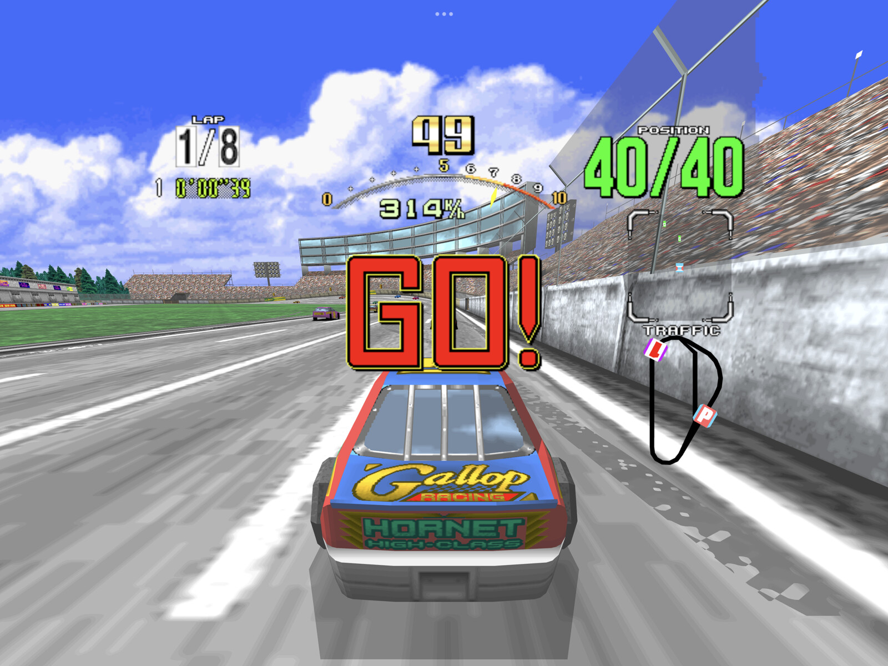
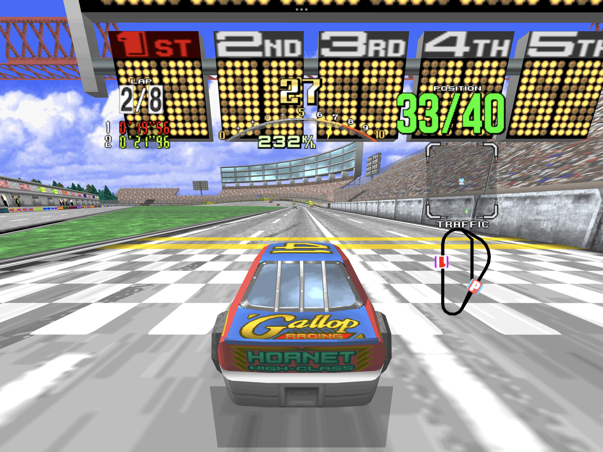
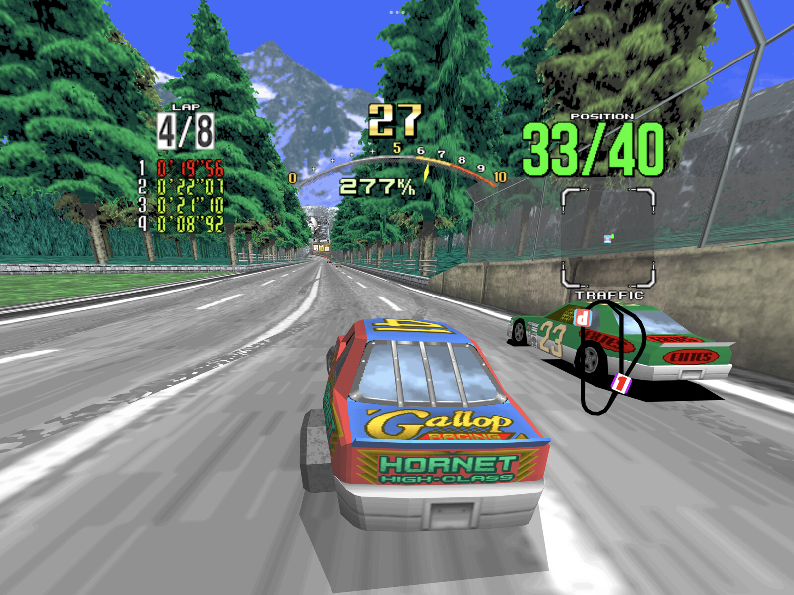
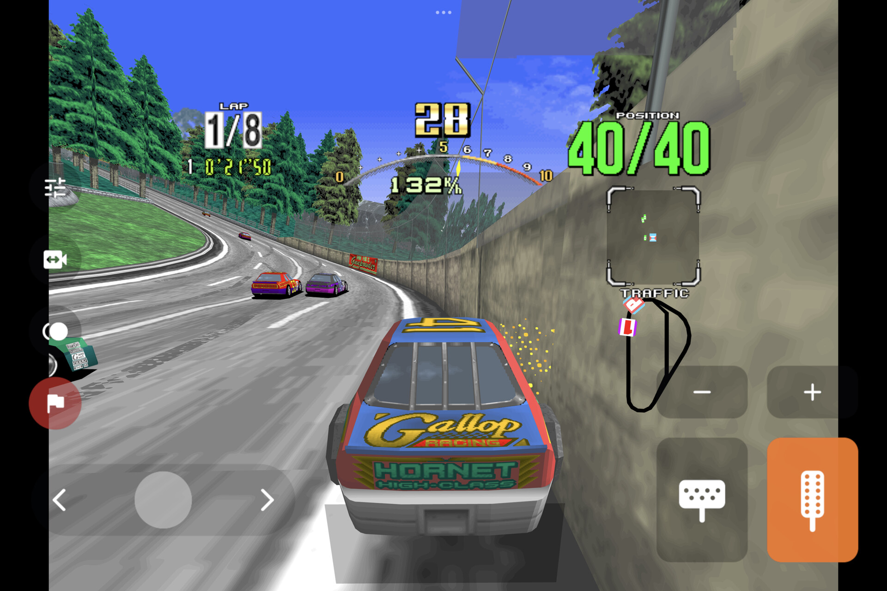
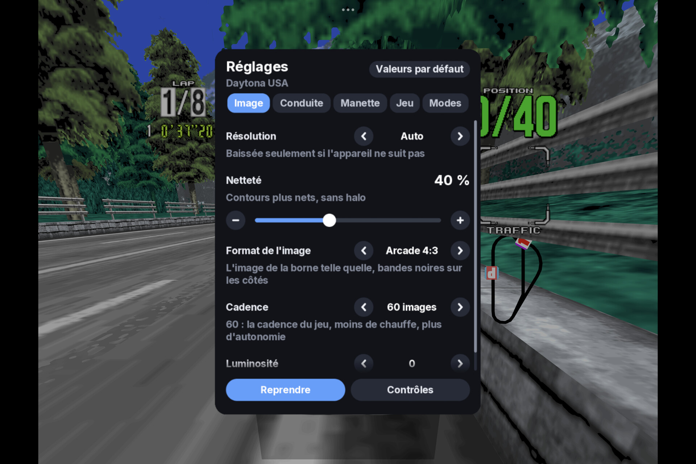
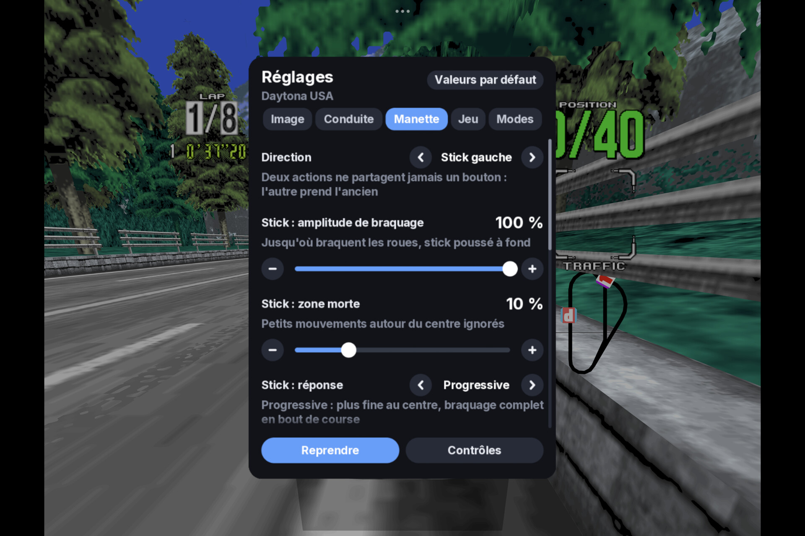

  

  <a href="https://port0r.com"><b>port0r.com</b></a> ·
  <a href="https://discord.gg/XMk7GgapuN"><b>Discord</b></a> ·
  <a href="https://github.com/jacquesdupontd/port0r/releases/tag/daytona-android-v0.1.0"><b>Download</b></a> ·
  <a href="https://port0r.itch.io/daytona-usa-vr"><b>itch.io</b></a> ·
  <a href="https://ko-fi.com/port0r"><b>Ko-fi</b></a> ·
  <a href="https://github.com/sponsors/jacquesdupontd"><b>Sponsor</b></a> ·
  <a href="https://youtu.be/75K8WlwFTeU"><b>Video</b></a> ·
  <a href="README.md#install-port0r-daytona-usa-vr"><b>Daytona USA VR on Meta Quest</b></a> ·
  <a href="DIRTDASH-ANDROID.md"><b>Dirt Dash on Android</b></a> ·
  <a href="ANDROID.md"><b>Sega Rally on Android</b></a>

# Daytona USA on Android

**Sega's 1994 arcade Daytona USA on your phone or tablet, free, from the people who made Port0r: Daytona USA VR.**

> ### Download Daytona USA for Android v0.1.0 (free)
> **[Port0r-DaytonaUSA-Android-v0.1.0.apk](https://github.com/jacquesdupontd/port0r/releases/download/daytona-android-v0.1.0/Port0r-DaytonaUSA-Android-v0.1.0.apk)**
> from the [release page](https://github.com/jacquesdupontd/port0r/releases/tag/daytona-android-v0.1.0). Then follow the
> [install guide](#install): a few minutes.

The race in **full screen**: the arcade's picture at its full height, HUD included, and the world widened to fill a
modern screen. Or the **cabinet's own 4:3 picture**, exactly as it was, between black bands (Settings > Image > Picture
format). Drawn by the same Vulkan renderer as Port0r: Daytona USA VR, at **60 images a second**, with a **dynamic
resolution** that keeps it smooth and a **sharpening** pass that keeps it crisp. **Touch controls designed for racing**,
steering by **turning or tilting the device**, a **gamepad**, the cabinet's **four views** and its **4-speed manual
gearbox**.

| Beginner start | Finish line | Forest |
| --- | --- | --- |
|  |  |  |
| **Touch controls** | **Settings** | **Gamepad** |
|  |  |  |

*All screenshots: captured on a Xiaomi Pad 7 (Snapdragon 7+ Gen 3), in the Arcade 4:3 picture format.*

---

## Contents

- [What you need](#what-you-need)
- [Install](#install)
- [Controls](#controls)
- [Settings](#settings)
- [Updates](#updates)
- [Troubleshooting](#troubleshooting)
- [Known limits](#known-limits)
- [Help, bugs, support](#help-bugs-support)
- [Credits and legal](#credits-and-legal)

## What you need

- An Android phone or tablet with **Android 8 or newer** and **Vulkan** (most devices from 2019 on). Tested on a
  Snapdragon 7+ Gen 3 tablet: 60 images a second at its full 3200x2136. On a lighter device the dynamic resolution
  lowers the picture's sharpness before the smoothness.
- **Your own** Daytona USA arcade files, made for **MAME 0.289**: `daytona.zip` and `model1io.zip`. Port0r never
  includes them and never says where to get them. No ROM requests on the Discord, please.
- Optional: a gamepad (Bluetooth or USB).

## Install

1. **Download** `Port0r-DaytonaUSA-Android-v0.1.0.apk` on the device and open it. Android asks to allow installing
   apps from your browser or file manager: allow it for that app, then install.
2. **Put your game files anywhere on the device**: `daytona.zip` and `model1io.zip`, **not unzipped**. The Download
   folder is the simplest.
3. **Open Port0r: Daytona USA.** The first time, it asks for **access to all files**, to find your game files wherever
   they are: allow it and come back. The game starts by itself.

If a file is missing or not the right version, the start screen names it and says what to do; it starts as soon as the
right files are there. Each Port0r game is its own app: Daytona USA, Dirt Dash and Sega Rally install side by side, and
next to Port0r: Daytona USA VR if you also play on a Quest.

## Controls

### On the screen

| Action | Touch |
|---|---|
| Steer | Put your left thumb anywhere on the left half and slide: the slider appears under it |
| Gas / brake | Bottom right: the brake, then the gas in the corner, side by side; slide from one to the other |
| Gears (manual transmission) | The − and + buttons above the pedals: the cabinet's 4-speed lever, one gear at a time |
| Pause, the settings | The settings button, at the top of the left column |
| Change view | The camera button, on the left: each press, the next of the cabinet's four views |
| Insert a coin / Start | The coin and flag buttons, on the left |

Every control can be made bigger, smaller or more transparent (Settings > Driving). **Progressive gas** (Settings >
Driving) turns the gas pedal into a gauge: slide up for more, from 30 % at its foot to full throttle at its top; off,
it is always full throttle.

### Steering with the device

Settings > Driving > Steering:
- **Turn the device**: hold it like a wheel and turn it.
- **Tilt the device**: tip the right edge down to turn right.

The left half of the screen is then the brake, the right half the gas. **Steering angle**, **smoothing**, **dead
zone**, **invert** and **Straight ahead = as I hold it now** (to recentre) are in the same tab. When a gamepad is in
use, the device's angle is ignored: the last thing you touched drives.

### With a gamepad

| Action | Button (default) |
|---|---|
| Steer | Left stick (or the right stick, or the d-pad: Settings > Gamepad > Steering) |
| Gas / brake | RT / LT (analog) |
| Gears (manual transmission) | RB up, LB down |
| Change view | Y |
| Start | A |
| Insert a coin | Select (a short press) |
| **Pause, the settings** | **Start** |
| Show / hide the touch controls | **Select held** (or L3) |
| In the settings | D-pad or stick to move, left / right to change, LB / RB tabs, A to choose, B to close |

Every action can be moved to another button in **Settings > Gamepad**; two actions never share a button (the other
one takes the old button). The touch controls disappear as soon as the gamepad is used, and come back when you touch
the screen.

## Settings

Start (or the settings button) pauses the game and opens the settings.

- **Image**: **Resolution** (Auto: lowered only when the device cannot keep up), **Sharpness**, **Picture format**
  (Full screen: the world widened to the screen's edges; Arcade 4:3: the cabinet's picture, black bands on the sides),
  **Frame rate** (60, the game's own rate, cooler and longer on battery; or the screen's maximum), **Brightness**.
- **Driving**: how you steer, the device's steering settings, the touch controls (on or off, opacity, size),
  progressive gas.
- **Gamepad**: the stick's steering range, dead zone and response, and every button.
- **Game**: vibrations, speed (the arcade's own, or 60 images a second), volume, language (ten languages), your
  Discord account.
- **Modes**: **Cabinet settings**, the cabinet's own menu (country, difficulty): View moves, Start chooses. Then
  switch it off.
- **Controls**: everything above, on one page.

## Updates

The game checks for a new Android version once at launch, in the background (never during a race; a failed connection
never stops you playing). When there is one, a short message says so on the start screen, and the settings panel shows
**Version X available** at the top: open it to read **what's new before installing anything**, then **Download and
install**. The download is checked against the release's SHA-256, then Android asks you to confirm the update; when it
is done, choose **Open** to start the new version. Your settings, records and game files are kept.

- Settings > Game > **Check for updates automatically** switches the launch check off; **Updates > Check now** checks
  whenever you want.
- The first time, Android asks you to allow the game to install apps (once).
- **Google Play Protect** asks again at every update installed from the game, because each new version is a file it has
  never seen (the package name does not change that): choose to install it, after its scan or without.
- Nothing is sent but the request to GitHub's public release list.

## Troubleshooting

| What you see | What to do |
| --- | --- |
| The start screen lists missing files | Put `daytona.zip` and `model1io.zip`, not unzipped, anywhere on the device (Download is the simplest), and allow file access if Android asks. They must be made for MAME 0.289. |
| It says a file is not the right version | Check your files against MAME 0.289 with a ROM manager; put the corrected ones anywhere on the device: they replace the old ones by themselves. |
| Google Play Protect asks to scan the app | It does so for every app installed outside the Play Store, and again for updates installed from the game: choose to install it (without scanning, or after the scan). |
| Installing is refused | Allow installing unknown apps for the app you downloaded with (your browser or file manager). |
| The car turns on its own | Steering is set to Turn or Tilt the device and the device is not held straight: Settings > Driving > Steering > Touch, or Straight ahead = as I hold it now. |
| Not smooth on my device | Settings > Image > Resolution: Auto, and Frame rate: 60. |
| Stuck anywhere | Ask on the [Discord](https://discord.gg/XMk7GgapuN): #install-help, or the bot in #ask-port0r. |

## Known limits

- First Android version of Daytona USA: tested on one tablet (Xiaomi Pad 7, Android 15) with a Bluetooth gamepad.
  Phones, Android TV boxes and other gamepads: tell us how it goes.
- In Full screen, the sides beyond the cabinet's 4:3 picture are drawn by Port0r (the arcade never showed them): now and
  then a bit of scenery appears late at the very edges. Picture format: Arcade 4:3 shows exactly the cabinet's picture.
- Racing wheels (Logitech G29 and others) are read, but not yet tuned on Android.

## Help, bugs, support

- **Discord**: https://discord.gg/XMk7GgapuN (#install-help, #bugs, #wishes, #leaderboard)
- **Bugs**: #bugs, or a [GitHub issue](https://github.com/jacquesdupontd/port0r/issues) with your device and Android
  version.
- **Support the project**: Port0r takes all my time right now. If you'd like to keep it going, you can sponsor it on [GitHub Sponsors](https://github.com/sponsors/jacquesdupontd) or buy me a coffee on [Ko-fi](https://ko-fi.com/port0r). Sharing it helps a lot too.

## Credits and legal

- Built from MAME's BSD-3-Clause source files (every component's license: [THIRD-PARTY-NOTICES.txt](THIRD-PARTY-NOTICES.txt)). Port0r: a free fan project, by the same people as [Port0r on Meta Quest](README.md) (arcade games
  in true 3D VR), [Sega Rally on Android](ANDROID.md) and [Dirt Dash on Android](DIRTDASH-ANDROID.md).

Daytona USA is a trademark of SEGA. Port0r is not affiliated with SEGA or Google. No game files are included, ever.
