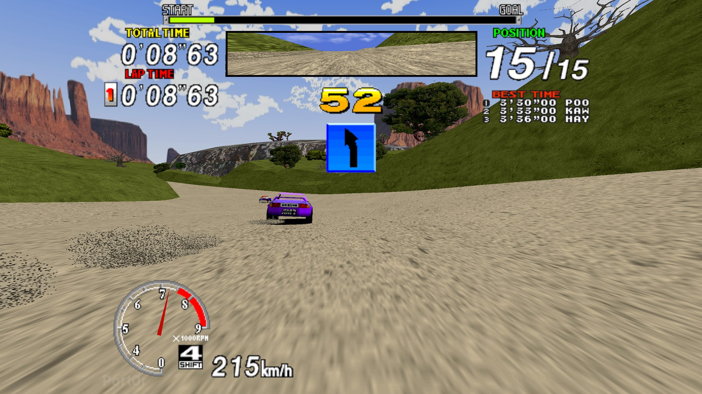

  

  <a href="https://discord.gg/XMk7GgapuN"><b>Discord</b></a> ·
  <a href="https://github.com/jacquesdupontd/port0r/releases/tag/mac-v0.1.0"><b>Download</b></a> ·
  <a href="https://ko-fi.com/port0r"><b>Ko-fi</b></a> ·
  <a href="https://github.com/sponsors/jacquesdupontd"><b>Sponsor</b></a> ·
  <a href="README.md"><b>Port0r on Meta Quest (VR)</b></a> ·
  <a href="LINUX.md"><b>Linux & Steam Deck</b></a> ·
  <a href="SWITCH.md"><b>Nintendo Switch</b></a> ·
  <a href="ANDROID.md"><b>Android</b></a>

# Sega Rally on Mac

**The 1995 arcade Sega Rally Championship on your Mac with Apple Silicon (no Rosetta, no Wine), free, from the people who made Port0r:
Rally VR.**

> ### Download Sega Rally for Mac v0.1.0 (free)
> **[Port0r-SegaRally-Mac-v0.1.0.tar.gz](https://github.com/jacquesdupontd/port0r/releases/download/mac-v0.1.0/Port0r-SegaRally-Mac-v0.1.0.tar.gz)**
> from the [release page](https://github.com/jacquesdupontd/port0r/releases/tag/mac-v0.1.0). Nothing to install:
> open it and play. Then follow the [install guide](#install).

The whole track in **true full screen**: the arcade's picture at its full height, HUD included, and the world widened to
fill your screen, at its **native resolution**. Drawn by the same renderer as Port0r: Rally VR, at **120 images a
second** on a MacBook Pro's ProMotion screen (60, 120, 180 or 240 on an external one), with **supersampling up to
200 %** and a **steady pacing** that gives every arcade frame exactly the same time on screen. Jean-seb's community
**HD textures** if you want them. Keyboard or **gamepad** (remappable), **video recording** of your races, and your times on the
**Port0r Discord leaderboard**.

*Screenshot: captured on a MacBook Pro M1 Pro, 2560x1440, HD textures on.*

---

## Contents

- [What you need](#what-you-need)
- [Install](#install)
- [Controls](#controls)
- [Settings](#settings)
- [Smoothness: 60, 120 Hz and more](#smoothness)
- [HD textures](#hd-textures)
- [The leaderboard on Discord](#the-leaderboard-on-discord)
- [Recording your races](#recording-your-races)
- [Your data](#your-data)
- [Updates](#updates)
- [Troubleshooting](#troubleshooting)
- [Known limits](#known-limits)
- [Help, bugs, support](#help-bugs-support)
- [Credits and legal](#credits-and-legal)

## What you need

- A **Mac with Apple Silicon**: M1, M2, M3, M4 and their Pro, Max and Ultra. Intel Macs are not supported.
- **macOS 12 Monterey** or newer. The app brings everything else it needs: nothing to install.
- **Your own** Sega Rally Championship arcade files, made for **MAME 0.289**: `srallyc.zip` and `segabill.zip`.
  Port0r never includes them and never says where to get them. No ROM requests on the Discord, please.
- Optional: a gamepad (Xbox, PlayStation, 8BitDo and the rest), Jean-seb's HD texture pack, and
  [ffmpeg](#recording-your-races) to record videos.

## Install

1. **Download** `Port0r-SegaRally-Mac-v0.1.0.tar.gz` and **open** it (double-click): you get **`Port0r Rally.app`**.
   Move it to **Applications** if you like.
2. **Put your game files in your Downloads folder**: `srallyc.zip` and `segabill.zip`, **not unzipped**.
3. **Open the app.** The first time, macOS asks you to confirm (see below). Then the game finds your files, copies them
   by itself, and starts. macOS may also ask once whether Port0r can look in your Downloads folder: say yes.

You can also **drop** a file on the game's window. If a file is missing or not the right version, the start screen names
it and says what to do; it starts as soon as the right files are there.

### The first launch: macOS asks once

Port0r is a free fan project without a paid Apple developer certificate, so macOS wants you to confirm the first time.

- **macOS 15 Sequoia and newer**: double-click the app and choose **Done**. Open **System Settings > Privacy &
  Security**, scroll down to **"Port0r Rally" was blocked**, click **Open Anyway** and confirm with your password or
  Touch ID.
- **macOS 12 to 14**: **right-click** (or Control-click) the app > **Open** > **Open**.

After that it opens like any other app.

## Controls

### Keyboard

The keys are read by their **place** on the keyboard: on AZERTY, Z Q S D drive like W A S D. **On a MacBook keyboard,
the F keys need fn** (fn+F9, fn+F11, fn+F12), unless you set them as standard function keys in System Settings >
Keyboard.

| Action | Key |
|---|---|
| Steer | Left / Right arrows, or A / D (Q / D on AZERTY) |
| Gas / brake | Up / Down arrows, or W / S (Z / S on AZERTY) |
| Gears (manual cars) | E up, Q down (A on AZERTY) |
| Change view | V |
| Insert a coin | 5 (the cabinet wants two per game) |
| Start | Return |
| **Pause, the settings** | **Escape** |
| Full screen | F11 (or Option+Return, or the window's green button) |
| Screenshot | F12 |
| **Record a video** of your race (see [Recording](#recording-your-races)) | **F9** (again to stop) |
| In the settings | Arrows to move and change, Return to choose, Tab / Shift+Tab for the tabs, Escape to close; the mouse and the trackpad work too (click, scroll) |

The mouse pointer hides by itself after two seconds without moving, and comes back as soon as you move it.

### Gamepad

| Action | Button (default) |
|---|---|
| Steer | Left stick (or the right stick, or the d-pad: Settings > Gamepad > Steering) |
| Gas / brake | RT / LT (analog) |
| Gears (manual cars) | RB up, LB down |
| Change view | Y |
| Start | A |
| Insert a coin | Select / View |
| **Pause, the settings** | **Start / Menu**, or **both sticks pressed together** |
| In the settings | D-pad or stick to move, left / right to change, LB / RB tabs, A to choose, B to close |

Every action can be moved to another button in **Settings > Gamepad**; two actions never share a button. Every gamepad
connected (USB or Bluetooth) is read at once, and rumbles on the knocks and the landings.

## Settings

Escape or Start pauses the game and opens the settings.

- **Image**: **Resolution** (Auto, 100, 75, 50 %, or **150 / 200 %** supersampling), **Frame rate** (the screen's
  maximum, or 60, 120, 180, 240), **Pacing** (Steady, or Lowest latency), **Full screen**, **Sharpness**, **HD
  textures**, **Brightness**, **Style** (colour, black and white, comic, night).
- **Gamepad**: every button.
- **Game**: vibrations, speed (the arcade's own, or 60 images a second), volume, language (ten languages), the Discord
  leaderboard, video recording, updates, the crash log.
- **Mods** (the Switch build's, same rules): free timer, free play, sporty automatic, adaptive steering, mirrored track,
  telemetry.

## Smoothness: 60, 120 Hz and more

The arcade makes **60 pictures a second**. It looks perfectly smooth when every picture stays on screen for the same
time, which takes a screen running at **60, 120, 180 or 240 Hz**.

- **MacBook Pro** (ProMotion, 120 Hz): nothing to do. Every arcade picture is shown exactly twice.
- **MacBook Air, iMac, Mac mini or Mac Studio on a 60 Hz screen**: nothing to do either.
- **External screen at 144 or 165 Hz**: pick **120 Hz** (or 60 Hz) in System Settings > Displays > Refresh rate. The
  game itself is steady; it is the screen's rhythm that does not divide by 60.
- **Pacing > Steady** (the default) holds every arcade picture exactly the same number of refreshes, for about 8 ms of
  added latency. **Lowest latency** removes it, with a rare uneven frame at 120 Hz and above.
- **Sharper edges**: Settings > Image > Resolution **150 or 200 %**. A MacBook Pro M1 Pro keeps 120 images a second at
  200 % of 2560x1440.

## HD textures

Jean-seb's community pack, optional. Leave its zip (any name) in your Downloads folder: it is set up by itself the next
time the game starts. Settings > Image > HD textures switches it on or off.

## The leaderboard on Discord

At the end of a game, Port0r offers to publish your times (Settings > Game). The first time, it shows a code: link your
Discord once, and your times land in #leaderboard on the [Port0r Discord](https://discord.gg/XMk7GgapuN).

## Recording your races

Port0r records your races itself, ready to share: on the Discord, we want to see your best runs.

- **It needs ffmpeg**, which macOS does not have. The simplest way: install [Homebrew](https://brew.sh), then
  `brew install ffmpeg` in Terminal. Without it, the menu says so and the game carries on.
- **Start / stop**: **F9** (fn+F9 on a MacBook), or the pause menu > **Game** > **Record a video**. It is always off
  when the game starts.
- **While it records**, a red dot blinks at the top right of the screen. It is not in the video.
- **What is recorded**: every arcade picture once, **exactly 60 images a second** whatever your screen's refresh rate,
  at your screen's resolution, menus included, with **the game's sound only** (lossless FLAC), nothing else from your
  Mac.
- **Encoded by the Mac's media engine** (VideoToolbox, in every Apple Silicon chip): the game keeps its pace while it
  records.
- **Where**: `~/Movies/Port0r/port0r-YYYYMMDD-HHMMSS.mkv`. QuickTime does not open `.mkv` files:
  [IINA](https://iina.io) or [VLC](https://www.videolan.org) do, and every video editor and site (YouTube, Discord)
  takes them.
- **Recording quality** (same tab, for the next recording):

| Profile | Picture | For |
|---|---|---|
| Maximum | your screen's resolution, HEVC, highest quality | editing your own video |
| **High** (default) | your screen's resolution, HEVC | sharing as it is |
| Balanced | up to 1080p, HEVC | lighter files |
| Light | up to 720p, H.264 | the smallest files |

## Your data

Everything lives in `~/Library/Application Support/Port0r/srallyc/`: the settings, the game's own copy of your files, the
HD pack and the screenshots (F12). In Finder, Go > Go to Folder and paste that path. Delete that folder to start from
scratch.

## Updates

The game updates itself. At launch it checks once, in the background, for a new Mac version on GitHub (never during a
race; a failed connection never stops you playing). When there is one, a notice **Version X available** shows for a few
seconds and the settings panel opens on **what's new, before anything is installed**; then **Download and install**.
The download is checked against the release's SHA-256 and replaces the app (the previous one is kept next to it as
`Port0r Rally.app.old`), and the game restarts on the new version. Your settings, records and game files are kept:
they live in your data folder.

- Settings > Game > **Check for updates automatically** switches the launch check off; **Updates > Check now** checks
  whenever you want.
- The app's folder must be writable: it is in Applications or in your home folder.
- This first version, v0.1.0, you download by hand; every version after it comes through the game.
- Nothing is sent but the request to GitHub's public release list.

## Troubleshooting

| What you see | What to do |
| --- | --- |
| "Port0r Rally" can't be opened / was blocked | The first-launch confirmation: see [The first launch](#the-first-launch-macos-asks-once). |
| The start screen lists missing files | Put `srallyc.zip` and `segabill.zip`, not unzipped, in your Downloads folder. They must be made for MAME 0.289. If macOS asked whether Port0r could look in Downloads and you said no: System Settings > Privacy & Security > Files and Folders > Port0r Rally > Downloads Folder. |
| It says a file is not the right version | Check your files against MAME 0.289 with a ROM manager; put the corrected ones in Downloads: they replace the old ones by themselves. |
| F9, F11 or F12 do nothing | On a MacBook keyboard, hold **fn**. |
| "Record a video" says ffmpeg is missing | `brew install ffmpeg` (see [Recording](#recording-your-races)), then restart the game. |
| It judders although the game is fast | Your screen's refresh rate does not divide by 60: see [Smoothness](#smoothness). |
| No sound after plugging in headphones or switching output | It comes back by itself in under a second. If it does not, tell us on the Discord. |
| Stuck anywhere | Ask on the [Discord](https://discord.gg/XMk7GgapuN): #install-help, or the bot in #ask-port0r. |

**When you report a bug**: switch on Settings > Game > **Crash log**. From then on the game keeps its own log, and if it
ever stops abnormally, the next launch puts **one** file in your Downloads folder, `Port0r-Rally-log.txt`: join it to
your report. It is off by default, and the log never grows beyond 8 MB.

## Known limits

- First Mac version: tested on a **MacBook Pro M1 Pro** (macOS 14 Sonoma, 120 Hz ProMotion screen at 2560x1440, keyboard and
  gamepad). **On other Macs, tell us how it runs** on the Discord, we fix fast.
- **Anti-aliasing (MSAA) is off on Mac** for now: the Mac's graphics driver faults with it. Supersampling (Resolution
  150 or 200 %) smooths the edges instead, and an M1 Pro has the power for it.
- The app is not signed with a paid Apple certificate: macOS asks once at the first launch.
- 120 images a second are the arcade's 60 each shown twice, perfectly even; truly new in-between pictures are not made
  yet.
- Racing wheels (Logitech G29 and others) are read as gamepads, not yet tuned.

## Help, bugs, support

- **Discord**: https://discord.gg/XMk7GgapuN (#install-help, #bugs, #wishes, #leaderboard)
- **Bugs**: #bugs, or a [GitHub issue](https://github.com/jacquesdupontd/port0r/issues) with your Mac's model, your
  macOS version, and the crash log if there is one.
- **Support the project**: Port0r takes all my time right now. If you'd like to keep it going, you can sponsor it on [GitHub Sponsors](https://github.com/sponsors/jacquesdupontd) or buy me a coffee on [Ko-fi](https://ko-fi.com/port0r). Sharing it helps a lot too.

## Credits and legal

- HD textures: Jean-seb.
- Built from MAME's BSD-3-Clause source files, SDL and MoltenVK (every component's license: [THIRD-PARTY-NOTICES.txt](THIRD-PARTY-NOTICES.txt)). Port0r: a free fan project, by the same people as
  [Port0r on Meta Quest](README.md) (arcade games in true 3D VR), [Sega Rally on Linux and the Steam Deck](LINUX.md),
  [on Nintendo Switch](SWITCH.md) and [on Android](ANDROID.md).

Sega Rally Championship is a trademark of SEGA. Mac and macOS are trademarks of Apple. Port0r is not affiliated with
SEGA or Apple. No game files are included, ever.
