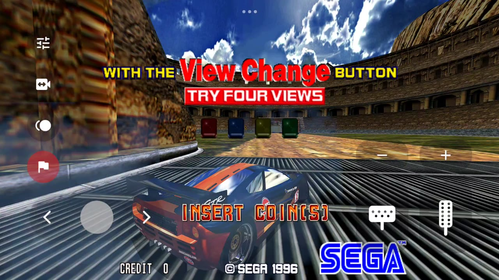
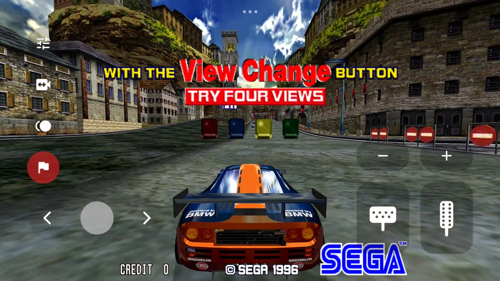
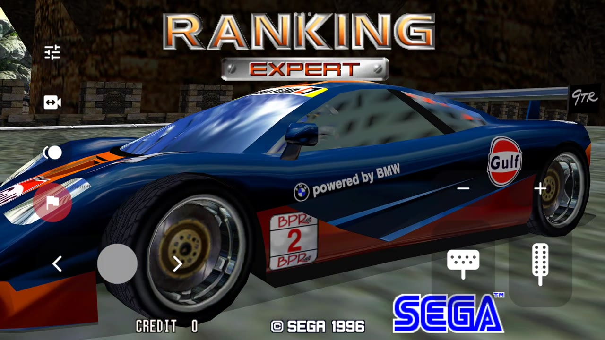

  

# Scud Race on Android

**Sega AM2's 1996 arcade Scud Race on your phone or tablet, free, from the people who made Port0r: Scud Race VR.**

> ### Download Scud Race for Android v0.1.0 (free)
> **[Port0r-ScudRace-Android-v0.1.0.apk](https://github.com/jacquesdupontd/port0r/releases/download/scud-android-v0.1.0/Port0r-ScudRace-Android-v0.1.0.apk)**
> from the [release page](https://github.com/jacquesdupontd/port0r/releases/tag/scud-android-v0.1.0). Then follow the [install guide](#install): a few minutes.

The race on your phone or tablet **in 4K at 120 FPS**, drawn by the same Vulkan renderer as Port0r: Scud Race VR. All the
Port0r settings you know, to make it play exactly the way you like. Optimised to the bone, to get the very best out of your
device. Touch controls on the screen, or a gamepad.

<table>
<tr><td align="center"> Touch controls</td><td align="center"> Beach run</td></tr>
<tr><td align="center"> The city</td><td align="center"> The ranking</td></tr>
</table>

*All screenshots: captured on a Xiaomi Pad 7 (Snapdragon 7+ Gen 3).*

---

## Contents

- [What you need](#what-you-need)
- [Install](#install)
- [Updates](#updates)
- [Troubleshooting](#troubleshooting)
- [Known limits](#known-limits)
- [Help, bugs, support](#help-bugs-support)
- [Credits and legal](#credits-and-legal)

## What you need

- An Android phone or tablet with **Android 8 or newer** and **Vulkan** (most devices from 2019 on). Tested on a
  Snapdragon 7+ Gen 3 tablet (Xiaomi Pad 7).
- **Your own** Scud Race arcade file, made for **MAME 0.289**: `scud.zip`. Port0r never includes it and never says where
  to get it. No ROM requests on the Discord, please.
- Optional: a gamepad (Bluetooth or USB).

## Install

1. **Download** `Port0r-ScudRace-Android-v0.1.0.apk` on the device and open it. Android asks to allow installing apps
   from your browser or file manager: allow it for that app, then install.
2. **Put your game file anywhere on the device**: `scud.zip`, **not unzipped**. The Download folder is the simplest.
3. **Open the game.** The first time, it asks for **access to all files**, to find your game file wherever it is: allow
   it and come back. The game starts by itself.

If the file is missing or not the right version, the start screen says so and what to do; it starts as soon as the right
file is there. Each Port0r game is its own app: Scud Race, Daytona USA, Dirt Dash and Sega Rally install side by side, and
next to Port0r: Scud Race VR if you also play on a Quest.

## Updates

The game checks for a new Android version once at launch, in the background (never during a race; a failed connection
never stops you playing). When there is one, the settings panel shows it: read **what's new before installing anything**,
then **Download and install**. The download is checked against the release's SHA-256, then Android asks you to confirm
the update. Your settings, records and game file are kept. **Google Play Protect** may ask again at every update installed
from the game, because each new version is a file it has never seen: choose to install it.

## Troubleshooting

| What you see | What to do |
| --- | --- |
| The start screen says the file is missing | Put `scud.zip`, not unzipped, anywhere on the device (Download is the simplest), and allow file access if Android asks. It must be made for MAME 0.289. |
| It says the file is not the right version | Check it against MAME 0.289 with a ROM manager; put the corrected one anywhere on the device. |
| Google Play Protect asks to scan the app | It does so for every app installed outside the Play Store: choose to install it (without scanning, or after the scan). |
| Installing is refused | Allow installing unknown apps for the app you downloaded with (your browser or file manager). |
| Stuck anywhere | Ask on the [Discord](https://discord.gg/XMk7GgapuN): #install-help, or the bot in #ask-port0r. |

## Known limits

- First Android version of Scud Race: tested on one tablet (Xiaomi Pad 7). Phones, Android TV boxes and gamepads: tell us
  how it goes.

## Help, bugs, support

- **Discord**: https://discord.gg/XMk7GgapuN (#install-help, #bugs, #wishes, #leaderboard)
- **Bugs**: #bugs, or a [GitHub issue](https://github.com/jacquesdupontd/port0r/issues) with your device and Android version.
- **Support the project**: Port0r takes all my time right now. If you'd like to keep it going, you can sponsor it on [GitHub Sponsors](https://github.com/sponsors/jacquesdupontd) or buy me a coffee on [Ko-fi](https://ko-fi.com/port0r). Sharing it helps a lot too.

## Credits and legal

- Built from MAME's BSD-3-Clause source files (every component's license: [THIRD-PARTY-NOTICES.txt](THIRD-PARTY-NOTICES.txt)). Port0r: a free fan project, by the same people as [Port0r on Meta Quest](README.md) (arcade games
  in true 3D VR), [Daytona USA on Android](DAYTONA-ANDROID.md) and [Sega Rally on Android](ANDROID.md).

Scud Race is a trademark of SEGA. Port0r is not affiliated with SEGA or Google. No game files are included, ever.
