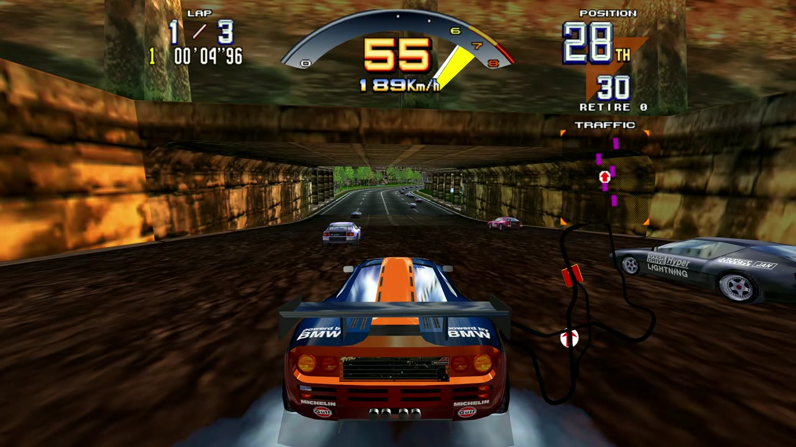
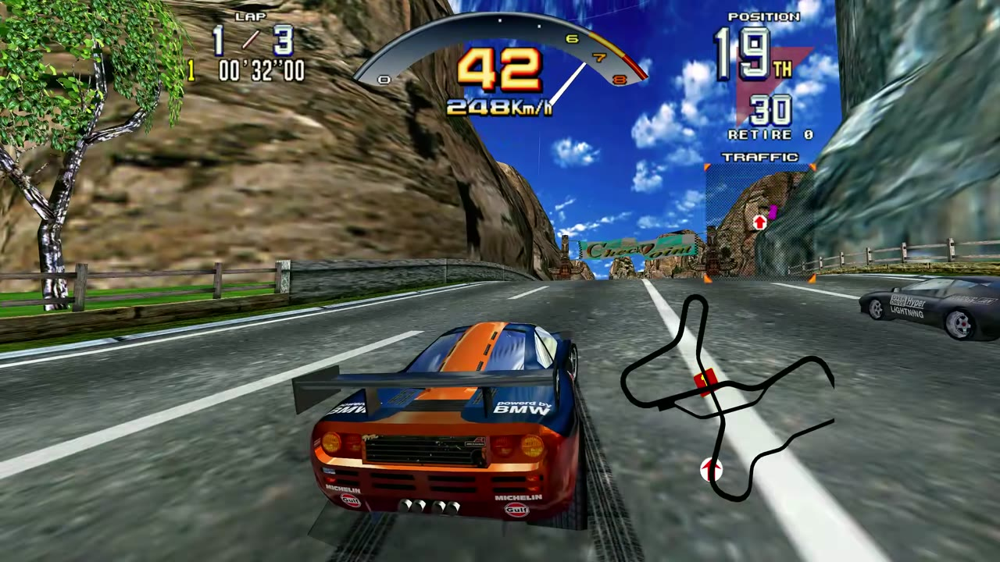
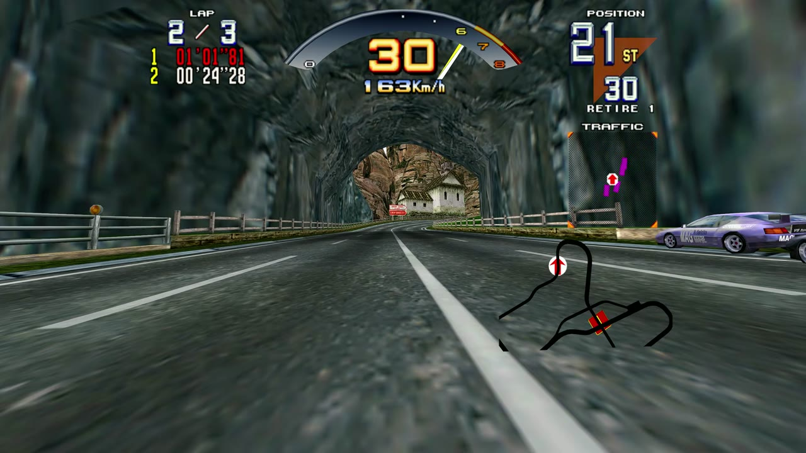
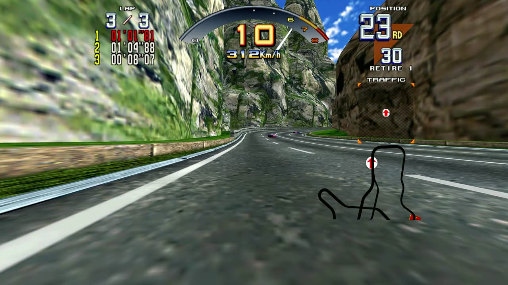

# Scud Race on PC: PCVR and desktop

**Sega AM2's 1996 arcade Scud Race on a Windows PC, free: in your VR headset through SteamVR or Quest Link, or on the
screen.**

> ### Download Scud Race for Windows PC v0.1.1 (free)
> **[Port0r-ScudRace-PC-0.1.1-Setup.exe](https://github.com/jacquesdupontd/port0r/releases/download/scud-pc-v0.1.1/Port0r-ScudRace-PC-0.1.1-Setup.exe)**
> (the installer), or **[Port0r-ScudRace-PC-0.1.1.zip](https://github.com/jacquesdupontd/port0r/releases/download/scud-pc-v0.1.1/Port0r-ScudRace-PC-0.1.1.zip)**
> to unpack anywhere without installing.

<table>
<tr><td align="center"> The canyon</td><td align="center"> Into the pack</td></tr>
<tr><td align="center"> The tunnel</td><td align="center"> Lap two</td></tr>
<tr><td align="center"> The launcher</td></tr>
</table>

## Contents

- [What you need](#what-you-need)
- [Install](#install)
- [Play in VR](#play-in-vr)
- [Play on the screen](#play-on-the-screen)
- [Your data](#your-data)
- [Updates and uninstall](#updates-and-uninstall)
- [Troubleshooting](#troubleshooting)
- [Help, bugs, support](#help-bugs-support)
- [Credits and legal](#credits-and-legal)

## What you need

- A **Windows 10 or 11** PC (64-bit) with a **Vulkan** graphics card (AMD, NVIDIA or Intel with a current driver).
  Tested on a Radeon RX 7800 XT.
- For VR: a PC VR headset through **SteamVR** (a Quest by Steam Link, a Valve Index, a Vive...) or a Quest by
  **Quest Link**.
- **Your own** Scud Race arcade file, made for **MAME 0.289**: `scud.zip`. Port0r never includes it and never says where
  to get it. No ROM requests on the Discord, please.
- Optional: a Logitech wheel or a gamepad.

## Install

1. **Download** `Port0r-ScudRace-PC-0.1.1-Setup.exe` and open it. The installer is not signed: if Windows shows
   "Windows protected your PC", click **More info**, then **Run anyway**. It installs for your account only, no
   administrator rights needed.
2. The **Port0r launcher** opens. Under **Game files**, click **Choose the files** and pick `scud.zip`, **not unzipped**,
   wherever it is. You do this once: the game reads it where it is.
3. Click **Play in VR** or **Play on the screen**.

## Play in VR

Start **SteamVR** with your headset first (or **Quest Link** on a Quest), then click **Play in VR** in the launcher. The
launcher shows the VR runtime it found; with none, it says to install SteamVR. The launcher comes back when you quit.

## Play on the screen

**Play on the screen** opens the game in a window: **F11** switches to full screen. The wheel, a gamepad or the keyboard
drive it.

## Your data

Your settings and records are in `%APPDATA%\Port0r\scud` (paste it in the File Explorer's address bar). The game itself is
in `%LOCALAPPDATA%\Programs\Port0r\ScudRace`.

## Updates and uninstall

- **Update**: download the new installer and open it. Your settings, records and file are kept.
- **Uninstall**: Windows Settings > Apps > Installed apps > **Port0r: Scud Race VR** > Uninstall. Your data stays in
  `%APPDATA%\Port0r\scud` until you delete that folder.

## Troubleshooting

- **"Windows protected your PC"**: the installer is not signed; **More info**, then **Run anyway**.
- **VR: the game says the headset is not ready**: start SteamVR (or Quest Link) first, check the headset shows the
  SteamVR home, then **Play in VR** again.
- **The file is missing**: the launcher marks it Ready or Missing; **Choose the files** again and pick the zip file
  itself, not its unpacked content.

## Help, bugs, support

[Discord](https://discord.gg/XMk7GgapuN) (#install-help, #bugs) or a GitHub issue.

Port0r is free. If you like it, you can sponsor it on [GitHub Sponsors](https://github.com/sponsors/jacquesdupontd) or
buy me a coffee on [Ko-fi](https://ko-fi.com/port0r). Sharing it helps a lot too.

## Credits and legal

Scud Race is a trademark of SEGA. Windows is a trademark of Microsoft. Port0r is a free fan project, not affiliated with
SEGA, Microsoft, Valve or Meta. Built from MAME's BSD-3-Clause source files; every component's license is in
[THIRD-PARTY-NOTICES.txt](THIRD-PARTY-NOTICES.txt).
